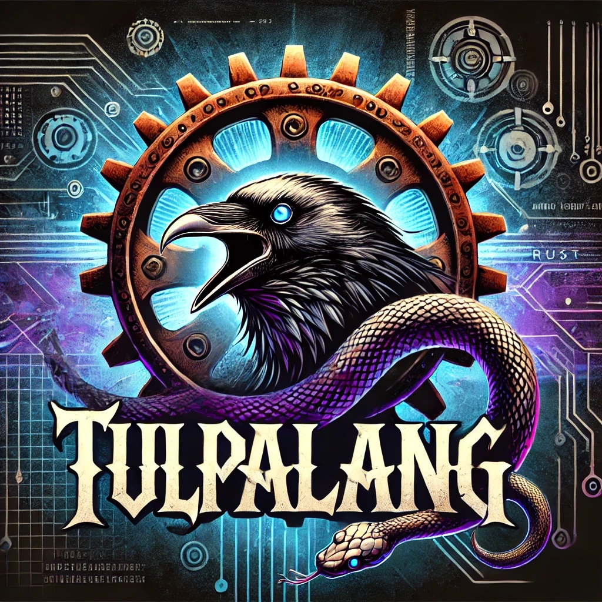

# Tulpa: A Multi-Paradigm Language for Device Integration

## Overview

Tulpa is a multi-paradigm programming language inspired by Python, powered by Rust, and enhanced with Hehner's algebraic notation. It is designed for high-performance computing and seamless device integration, making it an ideal choice for embedded systems, robotics, and hardware control.
___

___
## Features

- **Python-like Syntax**: Easy-to-read syntax inspired by Python, accessible to both beginners and experienced developers.
- **Rust Performance**: Utilizes Rust's LLVM backend for optimized, safe, and fast execution.
- **Device Integration**: Provides modules for controlling GPIO, I2C, SPI, and UART devices, enabling direct hardware interaction.
- **Async Programming**: Supports asynchronous programming to handle I/O-bound tasks effectively.
- **Macros**: Allows code generation and metaprogramming within the language.

## Getting Started

### 1. Installation

Clone the Tulpa repository and navigate to the project directory:

```bash
git clone https://github.com/LoQiseaking69/TulpaLang.git
cd TulpaLang
```

### 2. Building the Project

Build the Tulpa project using the provided build script:

```bash
./scripts/build.sh
```

### 3. Running Examples

Navigate to the examples directory and run the provided examples:

```bash
cd examples/hello_world
gluec main.rav
```

### 4. Using Device Modules

You can control devices using the modules provided in the `src/devices/` directory. For example, to control a GPIO pin:

```rust
let gpio = GPIO::new(17);
gpio.set_high();
```

## Documentation

- **[Language Guide](docs/language_guide.md)**: Detailed guide covering the syntax and features of Tulpa.
- **[Device Integration Guide](docs/device_integration.md)**: Instructions on integrating and controlling devices with Tulpa.

## License

Tulpa is licensed under the BSD 3-Clause License. See the `LICENSE` file for more details.
