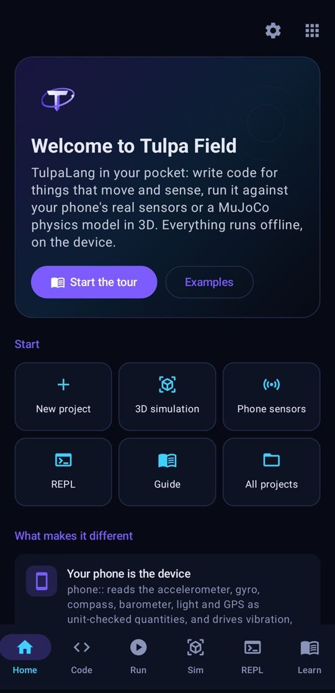
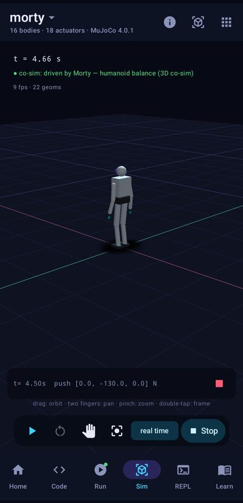
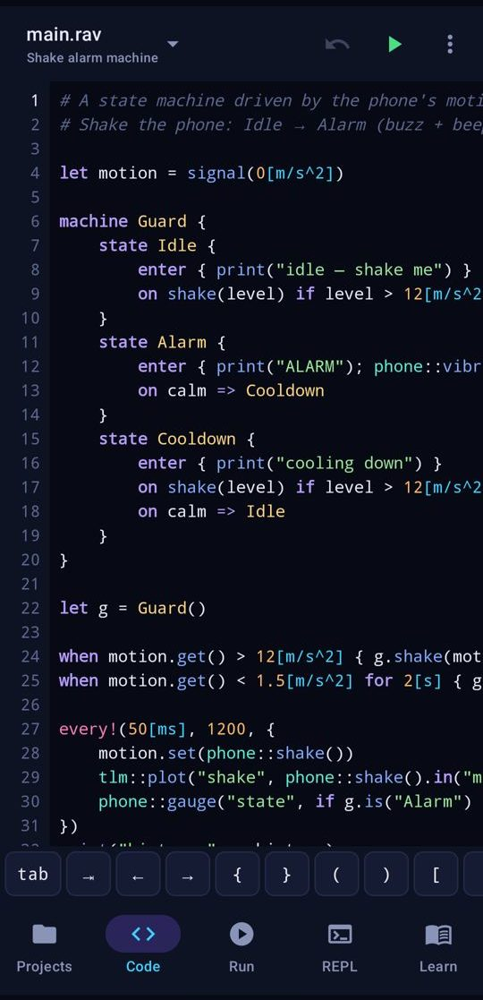
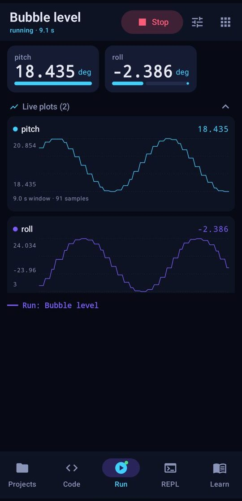

---


---
**A Python-flavoured, Rust-powered programming language for robotics, embedded systems, and physical computing.**

Tulpa builds physical units, engineering specifications, state machines, reactive programming,
timing constraints, and safety monitoring into the language itself, not into external libraries.

It is designed around a central idea: **software that interacts with the physical world should
be able to express the rules of that world.**

Dimensional correctness, actuator constraints, state transitions, response deadlines, and
hardware behaviour are all part of the programming model. The result is a language with the
accessibility of Python-style scripting, plus systems-oriented execution, engineering-aware
abstractions, and native hardware integration.

## At a glance

| Characteristic | Description |
|---|---|
| Language identity | Python-flavoured, expression-oriented programming language |
| Implementation | Rust |
| Primary domain | Robotics, mechatronics, embedded systems, physical computing |
| Execution | Tree-walking interpreter, bytecode VM, LLVM native compilation (host executables and RP2040 / ESP32 / Cortex-M / RISC-V firmware), the Tulpa VM for firmware (the whole language on a microcontroller), standalone bundles |
| Autonomy | Behavior trees, goal planning (GOAP), task decomposition (HTN), utility decisions, mission orchestration with replanning (`std/plan`) |
| Middleware | Tulpa Link: broker-less nodes, unit-typed topics, services, parameters, QoS, simulated and UDP transports (`std/link`) |
| Engineering model | Units, contracts, invariants, state machines, reactive rules, timing constraints |
| Hardware integration | GPIO, I2C, SPI, UART, PWM, Servo, PID, CAN, Bluetooth LE |
| Verification | Static proofs of contracts and invariants (`tulpa prove`), runtime contracts, contract fuzzing, safety monitors, exhaustive exploration, deterministic physics and chip emulation, record/replay |
| Developer tooling | REPL, test runner, LSP, VS Code extension, Mermaid state diagrams, [.RAV IDE](https://github.com/LoQiseaking69/.RAV_IDE), [Tulpa Field](android/README.md) for Android and [iOS](ios/README.md) |
| License | [Business Source License 1.1](LICENSING.md) (source-available; converts to Apache-2.0 after four years) |

## A language designed around physical systems

Most general-purpose languages can control hardware. Their engineering constraints, though,
usually live in libraries, conventions, or application-specific frameworks.

Tulpa makes many of those constraints first-class language constructs:

```tulpa
struct Joint {
    servo
    angle: [deg] = 90[deg]
    invariant 10[deg] <= self.angle and self.angle <= 170[deg]
    fn move_to(self, a: [deg]) { self.angle = a; self.servo.angle(a) }
}

let lift = Joint(Servo::new(0, 0))
let conveyor = GPIO::new(23)
let load = signal(0[kg])

machine Cell {
    on estop => Fault { conveyor.set_low() }

    state Idle {
        enter { lift.move_to(150[deg]); conveyor.set_high() }
        on part => Picking { conveyor.set_low() }   # stop the belt before the arm drops
    }

    state Picking {
        enter { lift.move_to(30[deg]) }
        on gripped(m) if m <= 2[kg] => Idle
        on gripped(m) => Fault
    }

    state Fault {
        on reset => Idle
    }
}

let cell = Cell()

when load.get() > 0[kg] {                                       # reactive rule
    cell.gripped(load.get())
}

always not (conveyor.read() == 1 and lift.angle < 60[deg]) else {  # safety envelope
    cell.estop()
}

fn stopping_distance(v: [m/s], decel: [m/s^2]) -> [m]
    require v >= 0 and decel > 0
    ensure result' >= 0
{
    v ** 2 / (2 * decel)
}
```

This example combines several of Tulpa's defining capabilities:

- **Dimensional analysis:** physical quantities carry units and enforce dimensional compatibility.
- **Engineering specifications:** functions and structures express preconditions, postconditions, and invariants.
- **State-driven behaviour:** machine states, events, guards, and transitions define operational behaviour.
- **Reactive control:** changes in sensors and signals can trigger application logic.
- **Safety monitoring:** continuous conditions can be expressed as executable constraints. If the
  `Picking` transition left the belt running, the `always` rule above would catch it the moment
  the lift drops below 60° and fire `estop`.
- **Hardware abstraction:** the same program runs against simulated or physical devices.

These are not separate frameworks loosely connected by application code. They are integrated
into the language's syntax, AST, runtime, tooling, and execution infrastructure. The full
pick-and-place cell is in [`examples/warehouse_robot`](examples/warehouse_robot/main.rav).

## What makes Tulpa different

Tulpa combines concepts found in scientific programming, formal specification languages,
reactive systems, PLC environments, and compiled systems languages. Individual concepts have
precedents. What sets Tulpa apart is integrating them into one accessible language aimed at
physical systems.

| Capability | Syntax | Engineering value |
|---|---|---|
| **Units of measure** | `0.5[m/s]`, `90[deg]`, `2200[mAh]` | Physical quantities carry dimensions, so adding speed to distance is a dimensional error rather than a silent bug. Conversions are built in: `.to("km/h")`, `.in("rad")`. |
| **Runtime-checked types** | `fn f(v: [m/s], n: int?) -> [m]` | Gradual typing. Annotate where needed and the interpreter enforces types, including unit dimensions. |
| **Hehner-style specifications** | `require`, `ensure`, `x'`, `result'`, `invariant` | Functions, loops, and structures express preconditions, postconditions, and invariants as executable specifications. |
| **Contract fuzzing** | `check(f)`, `tulpa verify` | Generates inputs that satisfy declared preconditions, tests postconditions, and shrinks failures to minimal counterexamples. Contracts become test oracles. |
| **Native state machines** | `machine`, `state`, `on ev(args) if guard => Target { action }` | Robot behaviour is explicit: states, guarded transitions, `enter`/`exit` hooks, global transitions, history, and `.can()`. `tulpa graph` generates Mermaid diagrams. |
| **Reactive signals** | `signal()`, `derive()`, `when cond { } else { }` | Reactive rules re-evaluate when signals, variables, or devices change. Edge-triggered. |
| **Timing rules** | `when cond for 25[ms]`, `after trigger within 300[ms] ensure response else { }` | Debouncing and bounded-response deadlines are language constructs. `--virtual-time` provides a simulated clock for testing timing behaviour. |
| **Safety envelopes** | `always cond [else { handler }]` | Runtime monitors are checked after device calls, assignments, transitions, and control ticks. A violation either stops execution or runs a handler. |
| **Record and replay** | `--record run.tape`, `--replay run.tape` | Captures hardware sessions with timestamps for regression testing without the hardware. Inputs replay over time, commands must match in order, and timing rules run against the recorded clock. |
| **Invariant-aware structures** | Fields, defaults, methods, invariants, operator overloading | Structure invariants are rechecked after method calls and field writes. A write that would violate an invariant is rolled back. |
| **Hardware integration** | GPIO, I2C, SPI, UART, PWM, Servo, PID, CAN, Bluetooth LE, `kin::` | Deterministic simulation by default; Linux hardware with `--hw`. GPIO goes through `/dev/gpiochipN` with a sysfs fallback, CAN through SocketCAN, and Bluetooth LE through `hci0`. |
| **Multiple execution tiers** | Interpreter, bytecode VM, LLVM native compilation | Interactive execution, automatic VM execution of eligible functions, and native compilation of whole programs (structs, devices, machines, monitors) to executables or firmware. |
| **Editor tooling** | VS Code extension, `tulpa lsp` | Diagnostics, unit-mismatch detection, undefined-name suggestions, hover, completions, symbols, and go-to-definition. Neovim and Helix setups are in [`editors/`](editors/README.md). |

## The architectural distinction

Tulpa brings together programming paradigms that are normally found in separate tools and
ecosystems.

| Programming discipline | Related established technologies | Tulpa implementation |
|---|---|---|
| Dimensional programming | Scientific computing, F#, Modelica | Units embedded in expressions; runtime type enforcement |
| Design by contract | Eiffel, SPARK, Dafny | Executable preconditions, postconditions, and invariants; contract fuzzing |
| State-based systems | UML Statecharts, SCXML | Native state-machine syntax and runtime |
| Reactive programming | ReactiveX, Lustre | Signals, derived values, reactive rules, event-triggered execution |
| Industrial control | IEC 61131-3, PLC environments | Device abstractions, state-driven logic, PID, timing constraints |
| Systems compilation | Rust, LLVM-based toolchains | Bytecode execution and LLVM native code generation down to microcontroller firmware |
| Hardware simulation | Hardware-in-the-loop, digital-twin workflows | Device simulation, record/replay, lock-step co-simulation |

Tulpa does not try to replace every language or framework in these disciplines. It aims to give
one programming environment where the relevant concepts from each can be used together.

## Execution architecture

Tulpa has three execution tiers:

1. **Tree-walking interpreter:** runs the whole language and backs the REPL.
2. **Bytecode VM:** eligible function bodies compile to bytecode on their first call and run
   automatically on a stack VM. In the benchmarks below, hot functions run about 4–5× faster.
   Constructs the VM doesn't cover fall back to the interpreter transparently.
3. **LLVM native compilation:** `tulpa build` emits textual LLVM IR for a whole program and
   compiles it with clang 14+. The output is a standalone executable (`--exe`, targets `sim` and
   `linux`), a firmware object for a microcontroller (`--target rp2040`, `esp32`, `esp32s3`,
   `esp32c3`, ...), or a shared library, each with a C header for integration. It compiles:
   - numbers, booleans, quantities with units, strings, and fixed-size arrays;
   - structs with invariants, methods and interfaces;
   - GPIO, I2C, SPI, UART, PWM and Servo devices;
   - state machines with parameters, guards and global transitions;
   - `always` monitors, `every!`/`repeat!` loops, `require`/`ensure` contracts;
   - `match` on numbers, ranges, alternatives, bindings and guards;
   - default and keyword arguments, `print` with f-strings and format specs;
   - top-level program code, and imported modules.

   Unit dimensions are checked at build time. Contracts, invariants and monitors stay in the
   generated code as runtime checks. Native output is tested byte for byte against the
   interpreter on the simulator, and on QEMU Cortex-M0 and RV32IMC.

The interpreter and VM run the whole language. Dicts, closures, `try`, tasks, signals and `when`
rules don't compile to static native code. Functions that use them are skipped, and each one is
reported with the reason.

**Deploying everything, everywhere.** A program outside the static subset still ships on every
target:

- **Microcontrollers.** `tulpa build --target rp2040 app.rav` compiles it to T-code and runs it
  on the Tulpa VM for firmware (`tulpa_dyn.c`, 107 KB of portable C). The whole language runs
  on a Pico or an ESP32: dicts, closures, `try`, tasks, signals, `std/plan`, `std/link`. The VM
  is tested against the interpreter under QEMU with the RP2040's memory budget.
- **Desktops and Linux boards.** `tulpa bundle app.rav -o app` makes a standalone executable
  that carries the runtime, the program and its imports. `tulpa build --exe` falls back to a
  bundle on those targets when a program is not fully native.

See [Native and embedded targets](docs/embedded.md).

## Verification and safety model

Tulpa layers several mechanisms to catch errors before they reach hardware:

- Type and dimensional checks
- Preconditions and postconditions
- Structure invariants
- Static proof (`tulpa prove`): `ensure` clauses, assertions, struct and loop invariants, call
  preconditions and non-zero divisors, for every input the `require` clauses allow
- Contract fuzzing and counterexample shrinking
- Exhaustive exploration of event orders (`std/verify`)
- Runtime safety envelopes
- Deterministic simulation
- Recording and replaying hardware sessions
- Differential testing between execution tiers

These mechanisms improve software verification and regression testing. `tulpa prove` gives
proofs of individual functions and methods over linear arithmetic (floats are treated as real
numbers). That is not a formal proof of the complete system, nor certification as a
safety-rated controller. Applications that
need functional-safety certification still require an appropriate independent safety
architecture, hardware protections, and a certification process.

## General-purpose language features

Although Tulpa is specialized for physical systems, it has the features expected of a
general-purpose scripting language:

- f-strings
- `match` with guards and list patterns (`[first, ..rest]`)
- Closures and keyword arguments
- The `|>` pipe operator
- Module imports, with a library search path for `std/`
- `try` / `catch`
- `const`
- `spawn` / `await` tasks
- Macros, including `every!` fixed-rate loops and `define_macro!`
- Interactive REPL
- Built-in test runner (`define_test!`, `tulpa test`)

## Libraries

Tulpa ships native modules plus a standard library written in Tulpa.

### Native modules

| Module | Functionality |
|---|---|
| `nn::` | Tensors, reverse-mode automatic differentiation, multilayer perceptrons, Adam/SGD, running scalers |
| `pack::` | Binary layouts (struct-style), `f32` arrays, CRC-16/32, COBS |
| `json::` | JSON encode/decode and files |
| `tlm::` | Live telemetry for plots and events |
| `cosim::` | Lock-step physics co-simulation over TCP |

### Standard library

The `std/` library provides higher-level engineering functionality implemented in Tulpa:

| Library | Functionality |
|---|---|
| `std/rtl` | Cycle-accurate RTL simulation and VCD waveform output |
| `std/eda` | Board-as-code: electrical rule checking, power budgets, netlists, and BOM generation |
| `std/rl` | Proximal Policy Optimization (PPO) on top of `nn::` |
| `std/lipm` | Linear inverted pendulum: capture point and Zero Moment Point (ZMP) |
| `std/topics` | ROS-style publish/subscribe messaging |
| `std/frame` | COBS + CRC packet framing |
| `std/plan` | Autonomy: behavior trees, GOAP, HTN, utility decisions, missions (3.4) |
| `std/link` | Tulpa Link middleware (3.4) |
| `std/world`, `std/emu`, `std/verify` | Deterministic physics, emulated chips with fault injection, exhaustive exploration (3.4) |
| `std/driver`, `std/drivers/*` | Driver SDK interfaces and helpers; MPU-6050, PCA9685 and MCP3008 drivers (3.3) |

See the [library guide](docs/libraries.md).

## Autonomy, middleware, simulation and proof (3.4)

Tulpa 3.4 adds the layers above the control loop, and the tools to trust them.

- **Autonomous reasoning and task orchestration.** `std/plan` has behavior trees, a GOAP
  planner, HTN decomposition, utility decisions, and a `Mission` that pursues prioritised
  goals, executes steps, monitors the world and replans. See [Autonomy](docs/autonomy.md).
- **Tulpa-native middleware.** Tulpa Link (`std/link`) connects nodes without a broker. Topics
  are typed by physical dimension and checked when nodes discover each other, values travel in
  SI, and QoS covers reliable, latched and deadline-monitored topics. It has services,
  parameters and liveliness, and runs on a deterministic simulated network or on UDP.
  See [Tulpa Link](docs/link.md).
- **Universal deployment.** `match` compiles natively. `tulpa bundle` makes a standalone
  executable with the whole language for desktops and Linux boards, and `tulpa build --exe`
  falls back to it. `tulpa deploy` runs prove → check → build → flash for a board project.
- **Unified simulation and verification.** `std/world` is a deterministic physics world.
  `std/emu` emulates the MPU-6050, PCA9685 and MCP3008 on the simulated bus, so the real
  drivers run in the loop, with fault injection. `std/verify` explores every event order.
  See [Simulation and verification](docs/simulation.md).
- **Formal safety guarantees.** `tulpa prove` statically proves contracts, invariants, call
  preconditions and non-zero divisors for all inputs, and reports counterexamples for what
  fails. See [Proving safety](docs/safety.md).

```
tulpa prove examples/verify/main.rav       # proved / REFUTED with a counterexample / unproved
tulpa examples/fleet/main.rav              # three nodes on a simulated lossy network
tulpa examples/sim_rover/main.rav          # physics → emulated chips → real drivers → controller
tulpa bundle examples/autonomy/main.rav -o mission && ./mission
```

## The whole language in firmware (3.5)

Before 3.5 a microcontroller could only run programs that fit the static native compiler. Now
`tulpa build --target <board>` takes any program:

```
tulpa build --target rp2040 examples/firmware_vm/main.rav -o app.o
  <program> is outside the static native subset (...)
  dynamic tier: 3 module(s), 4197 nodes, 98089 bytes of T-code; runs on the Tulpa VM (tulpa_dyn.c)
```

- **The Tulpa VM for firmware.** A program outside the static subset is compiled to T-code,
  which stays in flash and is executed in place by `tulpa_dyn.c`: 107 KB of portable C11 with a
  garbage collector, `try`/`catch`, closures, tasks, signals and reactive rules, structs,
  state machines, units, contracts, `pack::`, `json::`, and the devices. The project templates
  build it in, and the linker drops it from firmware that doesn't use it.
- **Checked against the interpreter.** The conformance programs in `tests/dyn/` and the
  examples must print the same output on the VM as on the interpreter: on the host, as
  Cortex-M0 code with the RP2040's 256 KB of RAM under QEMU, and as RV32IMC (the ESP32-C3's
  instruction set). CI also builds the VM into real Pico SDK and ESP-IDF firmware.
- **Tulpa Link on the board.** The VM contains a Tulpa Link node written in C that speaks the
  same wire format as the host. An ESP32 joins the fleet over Wi-Fi; a Pico joins over a UART
  and `tulpa link bridge /dev/ttyUSB0` on the computer at the other end.
- **Planning on the board.** `std/plan` runs in firmware, so a behavior tree or a GOAP planner
  can live on the robot's own microcontroller.

```
tulpa run --virtual-time examples/firmware_vm/main.rav       # the interpreter
tulpa build --target sim --exe --dynamic examples/firmware_vm/main.rav -o vm && ./vm   # the firmware VM, on this machine
tests/firmware/run_qemu_dyn.sh m0 examples/firmware_vm/main.rav                        # the VM as Cortex-M0 firmware
```

See [Native and embedded targets](docs/embedded.md#the-whole-language-on-a-microcontroller) for
footprint, tuning, and what stays on the host.

## Standalone robotics software (3.3)

Tulpa 3.3 compiles whole programs to native code, from the simulator all the way to a
microcontroller.

- **Driver SDK.** Write a driver once, in Tulpa, against a typed interface, then run it in the
  simulator, on a Raspberry Pi, or in firmware. `std/driver` has the `Driver`, `Imu`,
  `Thermometer`, `Rangefinder`, `Adc` and `PwmController` interfaces, plus bit helpers that
  compile natively. `std/drivers/` has reference drivers for the MPU-6050, PCA9685 and MCP3008.
- **Native driver compilation.** LLVM codegen covers structs and invariants, interfaces,
  devices, state machines, `always` monitors, `every!` loops and top-level code. Native output
  is tested byte for byte against the interpreter.
- **Embedded backend.** There are targets for RP2040, ESP32, ESP32-S2/S3/C3/C6, and generic
  Cortex-M0/M4F and RV32. A portable C runtime runs on board HALs for the Pico SDK, ESP-IDF,
  Linux and the simulator. `tulpa new --board` scaffolds a ready-to-build firmware project.

```
tulpa new rover --board rp2040 && cd rover
tulpa --virtual-time app.rav              # try it on the simulator first
cmake -B build && cmake --build build      # → build/rover.uf2
```

See the [Driver SDK](docs/drivers.md) and [Native and embedded targets](docs/embedded.md).

## .RAV IDE integration

The [.RAV IDE](https://github.com/LoQiseaking69/.RAV_IDE) IDE bundles Tulpa with:
- a MuJoCo co-simulator
- a waveform viewer
- state-machine diagrams
- live plots
- native and firmware builds: **Run Natively**, **Build Firmware for Board…** and **New Firmware Project…** (.RAV IDE 2.1)
- a **Proofs** dock for `tulpa prove`, **Deploy Project to Board…**, **Bundle Standalone Executable**, a Tulpa Link **Network** dock, and the bundled Autonomy lab project (.RAV IDE 2.2)
- firmware builds for any program (static native code or the Tulpa VM, reported in the build output), **Link Bridge to Board…** for a board on a serial port, and the Firmware VM lab project (.RAV IDE 2.3)

It also has a Windows installer.

Its Morty humanoid project is written entirely in Tulpa. It shows the language working inside a
larger robotics and simulation environment:
- balance control
- a physics-informed model
- PPO
- an RTL torque governor
- the mainboard as code

## Tulpa Field (Android and iOS)

<p align="center">
  <a href="android/README.md"></a>
  <a href="android/README.md"></a>
  <a href="android/README.md"></a>
  <a href="android/README.md"></a>
</p>

[`android/`](android/README.md) and [`ios/`](ios/README.md) are **Tulpa Field**, a pocket IDE that runs the whole Tulpa runtime
on the phone, offline, on Android and on iPhone/iPad. It turns the handset into a device you can program:

- the `phone::` module reads the accelerometer, gyro, magnetometer, orientation, light, barometer,
  proximity, battery, steps and GPS as unit-checked quantities, and drives vibration, the torch,
  speech, tones and notifications
- MuJoCo on the device with a 3D view: `cosim::` programs (and .RAV IDE workspaces) run unchanged
- live `tlm::plot` charts and `phone::gauge` readouts while a program runs
- a touch-first editor with diagnostics, completion and a symbol/unit keyboard bar
- a REPL, a tappable state-machine inspector, and one-tap contract verification and tests
- the Driver SDK: `std/driver` interfaces and the bundled drivers, plus an example that implements `Imu` on the phone's own sensors
- planning (`std/plan`), Tulpa Link on a simulated network, and physics with emulated chips
- 36 runnable examples, including the Morty humanoid, and an in-app guide whose code blocks run with one tap

The signed APK and the iOS IPA are built by CI and attached together to `field-v*` releases (older
Android-only builds are `android-v*`). The IPA installs without an Apple Developer account through
AltStore, SideStore or Sideloadly with a free Apple ID ([iOS README](ios/README.md)). See the
[Tulpa Field page](https://loqiseaking69.github.io/TulpaLang/android.html) on the website. Screenshots, features and build
instructions are in the [Tulpa Field README](android/README.md). Other hosts can embed the runtime the
same way through `tulpa::embed` (run/REPL/analysis API) and `tulpa::host` (host-provided modules).

## Install

Download a release package from [Releases](https://github.com/LoQiseaking69/TulpaLang/releases).
The `release` workflow builds them on every `v*` tag. The latest release is **v3.5.0**.

- **Linux** (x86_64, arm64 for Raspberry Pi 3/4/5, armv7): download
  `tulpa-<version>-<target>.tar.gz`, unpack it, and run `./install.sh`, or
  `sudo ./install.sh /usr/local`.
- **Debian / Ubuntu / Raspberry Pi OS:** `sudo apt install ./tulpa_<version>_<arch>.deb`
- **macOS:** `tulpa-<version>-<x86_64|aarch64>-apple-darwin.tar.gz`
- **Windows:** use the [.RAV IDE installer](https://github.com/LoQiseaking69/.RAV_IDE),
  which bundles `tulpa.exe` and the `std/` library, or build from source.
- **VS Code:** `code --install-extension tulpa-lang-<version>.vsix`. The `.vsix` is attached to
  each release. The extension is not on the VS Code Marketplace yet.

Build from source:

```bash
cargo build --release
```

This requires Rust 1.82 or later. `scripts/release.sh` builds all the packages for the host.

## Quick start

```bash
cargo build --release
T=./target/release/tulpa

$T examples/warehouse_robot/main.rav        # machine + signals + safety envelope + servos
$T examples/units/main.rav                  # dimensional analysis
$T verify examples/verify/main.rav          # fuzz every contracted function
$T --virtual-time examples/timing/main.rav  # debounce + deadlines on a simulated clock
$T build examples/native/main.rav -o ctl.o  # native object + ctl.h for firmware (needs clang 14+)
$T build examples/drivers/main.rav --target sim --exe -o drv && ./drv   # whole program, native
$T new rover --board esp32c3                # ESP-IDF firmware project (also rp2040, esp32s3, linux)
$T bytecode examples/units/main.rav         # inspect VM compilation
$T examples/fieldbus/main.rav               # CAN motor controller + BLE battery gauge
$T graph examples/warehouse_robot/main.rav  # Mermaid state diagrams
$T --record run.tape robot.rav              # capture device traffic
$T --replay run.tape robot.rav              # regression-test recorded traffic
$T test tests/tulpa/std_test.rav            # define_test! blocks
$T                                          # REPL
sudo $T --hw robot.rav                      # real hardware on a Pi
```

To install the binary, run `scripts/deploy.sh [PREFIX]`. To cross-compile for a Raspberry Pi, run
`scripts/cross_compile.sh`.

## Best use cases

### 1. Robotics and mechatronics
Tulpa's language constructs map directly onto what physical systems need:
- State machines represent operational behaviour.
- Reactive rules connect sensor conditions to events.
- Safety envelopes express conditions that must always hold.
- Units preserve dimensional correctness.
- Device abstractions connect logic to actuators and sensors.
- Simulation supports development before deployment.

### 2. Hardware regression testing
Record a session on a real device, then replay it during later development and CI runs. That way
software changes are tested against recorded hardware interactions without needing the physical
rig for every test.

### 3. Safety-oriented control logic
Contracts, structure invariants, dimensional checks, and runtime monitors catch invalid
operations and unexpected states. `tulpa verify` searches for contract violations before
deployment. These mechanisms complement certified safety systems and independent hardware
safeguards; they do not replace them.

### 4. Sensor and actuator bring-up
Probe hardware buses with `I2C::scan()`, inspect registers from the REPL, and watch device
transactions with `--trace`.

### 5. Embedded systems and control education
Python-like syntax, simulated hardware, built-in PID and kinematics, and readable dimensional
errors make a practical environment for learning programming, control theory, and hardware
integration.

### 6. Engineering simulation and experimentation
Together, `nn::`, `cosim::`, `std/rtl`, `std/eda`, and `std/rl` support experiments across
numerical computation, simulation, hardware design, and control development.

## Design philosophy and originality

Tulpa's originality is not a claim that state machines, dimensional analysis, contracts, or
reactive programming are new. Each is an established idea with a long history across
programming languages and engineering disciplines.

What distinguishes Tulpa is making them cooperate as native parts of one language:

- A physical quantity carries dimensional information through an expression.
- A function specifies the conditions under which it is valid.
- A structure enforces its own engineering invariants.
- A state machine represents the lifecycle of a physical process.
- Reactive rules connect changing inputs to state transitions.
- Timing constructs express bounded-response requirements.
- Safety monitors enforce runtime conditions.
- Recorded hardware sessions become repeatable regression tests.
- The same program moves from the interpreter to a native executable or microcontroller firmware.

The result is a programming model for software whose correctness depends on physical dimensions,
device state, timing, and operational constraints, not just computed output.

Tulpa is best understood as an engineering-oriented language for robotics and physical systems.
It is not simply a Python alternative or a hardware-control library.

## Current scope

Tulpa already has a substantial language implementation, runtime, tooling, hardware abstraction
layer, and engineering library ecosystem. Its next stage is about expanding execution coverage,
strengthening system-level guarantees, and improving adoption.

Some important boundaries of its current scope:

- Static native compilation covers structs, devices, state machines, monitors, `match` and
  timing loops, but not dicts, closures, `try`, tasks or signals. A program that uses those
  runs on the Tulpa VM for firmware on a microcontroller, at interpreter speed and with about
  200 KB of flash and 40 KB of RAM for the VM. One firmware image is either static native
  code or a VM program, not a mix.
- `nn::`, `cosim::`, the fieldbus modules (BLE, CAN, Modbus), file access and contract fuzzing
  run on desktop and Linux targets only.
- `tulpa prove` proves properties of individual functions over linear arithmetic, treating
  floats as real numbers. Non-linear obligations come back unproved, and it does not cover
  timing or whole-system behaviour.
- Tulpa Link has no encryption or authentication. A microcontroller without a network stack
  joins over a UART through `tulpa link bridge` on a computer.
- `std/world` is a 2-D model for mobile robots. Full rigid-body dynamics come from MuJoCo
  through .RAV IDE.
- Contract fuzzing explores test cases; it is not a mathematical proof of correctness.
- Runtime safety envelopes detect violations at defined checkpoints. They are not independent
  hardware safety interlocks.
- Record/replay validates recorded software interactions and timing. It does not establish
  equivalence between a simulation and the physical world.
- Whether Tulpa suits production depends on the target hardware, workload, timing requirements,
  testing, and safety architecture.

These boundaries separate an ambitious engineering language implementation from a fully
validated industrial control platform.

## Docs

The full documentation, with search, a quick start, a CLI reference, an example gallery and the
.RAV IDE guides, is on the **[Tulpa website](https://loqiseaking69.github.io/TulpaLang/)**.
Its source is in [`website/`](website/README.md). The guides below are rendered there directly.

- [Language guide](docs/language_guide.md): syntax, types, units, structs, machines, reactive
  rules, verification, modules, and the standard library.
- [Library guide](docs/libraries.md): `nn`, `pack`, `json`, `tlm`, `cosim`, and the `std/`
  library.
- [Device integration guide](docs/device_integration.md): devices, backends, the simulator,
  record/replay, and wiring notes.
- [Driver SDK](docs/drivers.md): interfaces, `std/driver`, and writing drivers in Tulpa that
  compile natively.
- [Native and embedded targets](docs/embedded.md): `tulpa build --target`, RP2040 and ESP32
  projects, bundles, the runtime layers, and porting to a new board.
- [Autonomy](docs/autonomy.md): behavior trees, planning, decomposition and missions.
- [Tulpa Link](docs/link.md): the middleware, its QoS, tools and wire format.
- [Simulation and verification](docs/simulation.md): physics, emulated chips, exploration,
  and `tulpa deploy`.
- [Proving safety](docs/safety.md): `tulpa prove` and what it guarantees.

## Project layout

```
src/lexer.rs       tokens: comments, f-strings, hex/bin literals, primes x', unit brackets
src/parser.rs      Pratt parser → AST (src/ast.rs): structs, machines, when/always, import, |>
src/interp.rs      evaluator core: scopes, closures, contracts, macros, tasks
src/ext.rs         units math, kwargs, types, structs, machines, signals, reactive rules,
                   safety monitors, modules + library search path, contract fuzzing
src/vm.rs          bytecode compiler + VM (automatic tier for eligible functions)
src/llvm.rs        LLVM IR generator: structs, devices, machines, monitors (tulpa build / emit-llvm)
src/native.rs      targets, firmware project scaffolding, import flattening
src/prove.rs       static prover (tulpa prove)
src/link.rs        Tulpa Link transport core (tlink::), wrapped by std/link
src/lower.rs       lowering passes before native codegen (match → if chains)
src/bundle.rs      standalone executables that carry the runtime and the program
src/dyncode.rs     T-code: the program image the firmware VM executes
runtime/           C runtime + HAL ports (sim, linux, pico, esp_idf) and board templates
runtime/dyn/       the Tulpa VM for firmware (shipped as one file, tulpa_dyn.c)
src/lsp.rs         language server (tulpa lsp)
src/units.rs       dimensional analysis (SI base vector, unit parser, conversions)
src/builtins.rs    standard library, kin:: module, string/list/dict methods, formatting
src/nn.rs          nn:: tensors, reverse-mode autodiff, layers, optimisers
src/stdx.rs        pack:: json:: tlm:: cosim::
src/embed.rs       embedding API for host apps (run, REPL sessions, cancel, editor analysis)
src/host.rs        registry for host-provided native modules (e.g. phone:: in Tulpa Field)
stdlib/            std/ library written in Tulpa (rtl, eda, rl, lipm, topics, frame, driver, drivers/, plan, link, world, emu, verify)
src/devices/       GPIO/I2C/SPI/UART/PWM/Servo/PID/CAN/BLE; sim.rs, linux.rs, tape.rs (record/replay)
examples/          runnable programs with expected.txt (checked by cargo test)
tests/             Rust tests (run under both tiers), Tulpa-level tests, firmware/ QEMU scripts
editors/           VS Code extension (editors/vscode) + Neovim/Helix setup
scripts/           release.sh (tarball, .deb, .vsix), deploy.sh, cross_compile.sh
website/           project website + docs site (GitHub Pages), see website/README.md
android/           Tulpa Field, the Android IDE (Rust JNI bridge + Kotlin/Compose app)
ios/               Tulpa Field for iOS (Rust C-ABI bridge + SwiftUI/Metal app)
```

## Performance

Release-build benchmarks:

| Benchmark | Interpreter | VM (default) | Native (`tulpa build`) |
|---|---|---|---|
| `fib(30)`, call-heavy | 1.15 s | 0.28 s | 0.005 s |
| 1M-iteration loop + 1M-step PID simulation | 1.39 s | 0.28 s | — |

Every test runs under both the interpreter and the VM (`TULPA_NO_VM=1`). Native output is
differential-tested against the interpreter.

## Roadmap

### Shipped
- **2.0:** units of measure, runtime-checked types, keyword arguments, `|>`, structs with
  invariants, state machines, signals and `when` rules, `always` monitors, modules, contract
  fuzzing (`tulpa verify`), record/replay, PWM and Servo.
- **3.0:** the bytecode VM, LLVM code generation, the gpiochip backend, timing rules
  (`when … for`, `after … within … ensure`), the virtual clock, and the LSP.
- **3.1:** unit-typed native code, CAN and Bluetooth LE, timestamped replay, the VS Code
  extension, and release packaging.
- **3.2:** the `nn`, `pack`, `json`, `tlm`, and `cosim` modules; the `std/` library (rtl, eda,
  rl, lipm, topics, frame); operator overloading for native objects; and the library search path.
- **3.3:** interfaces and the Driver SDK (`std/driver`, MPU-6050, PCA9685 and MCP3008 drivers);
  native compilation of structs, devices, state machines, `always` monitors and `every!`
  loops; standalone executables (`--exe`); embedded targets for RP2040, ESP32, ESP32-S2/S3/C3/C6
  and generic Cortex-M/RISC-V, with `tulpa new` firmware projects and a portable C HAL.
- **3.3.1:** documentation brought in line with 3.3 across the README, guides and website.
- **3.3.2:** `sim::virtual_time(true)` starts the simulated clock at 0, like `--virtual-time`,
  so simulated runs are reproducible however long start-up takes.
- **3.4:** autonomy (`std/plan`), Tulpa Link middleware (`std/link`), static proofs
  (`tulpa prove`), deterministic physics and chip emulation (`std/world`, `std/emu`),
  exhaustive exploration (`std/verify`), native `match`, standalone bundles (`tulpa bundle`)
  and `tulpa deploy`.
- **3.5:** the whole language on microcontrollers: the Tulpa VM for firmware (`tulpa_dyn.c`),
  which `tulpa build --target <board>` uses for programs outside the static subset; a Tulpa
  Link node in firmware over UDP (ESP32, Linux) and UART, with `tulpa link bridge`; `pack::`
  and `json::` in firmware; licensed under the Business Source License 1.1.
- **Tulpa Field:** the Android IDE, the `phone::` host module, and the `tulpa::embed` /
  `tulpa::host` embedding API.

### Planned
- CAN-FD and ISO-TP (UDS diagnostics) on top of the CAN layer.
- BLE peripheral (GATT server) mode, so a Raspberry Pi can act as a sensor.
- Static and VM code in one firmware image (a native control loop calling into a VM program).
- Encryption and authentication for Tulpa Link.
- More reference drivers (BMP280, VL53L0X, INA219) and a board-support package for STM32.
- Publishing the VS Code extension to the Marketplace and Open VSX.
- A package registry for Tulpa modules.

## License

Business Source License 1.1 from version 3.5.0: free for development, evaluation, education, research and personal projects; commercial production use needs a license from HermiTech LLC; each version becomes Apache-2.0 four years after its release. See [`LICENSING.md`](LICENSING.md) and [`LICENSE`](LICENSE). Versions up to 3.4.0 remain BSD 3-Clause.
