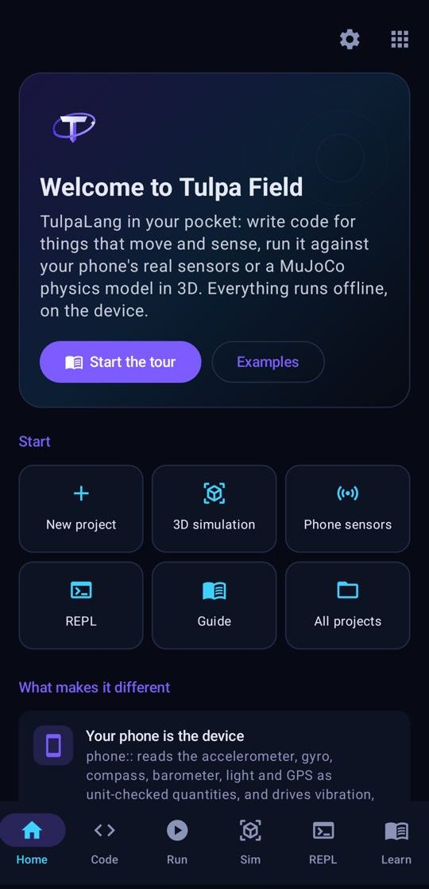
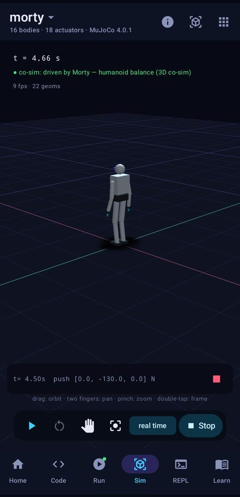
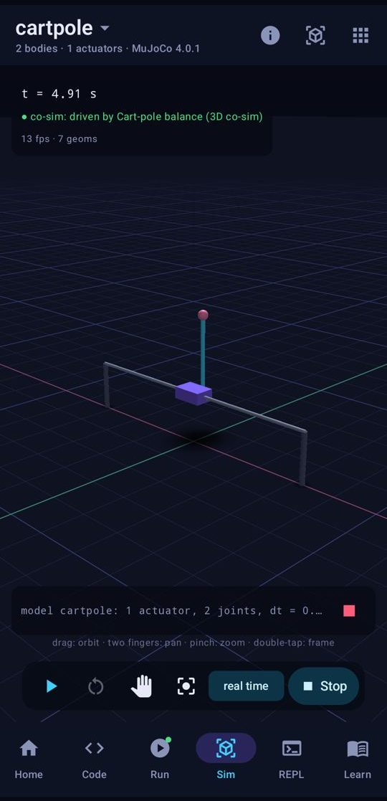
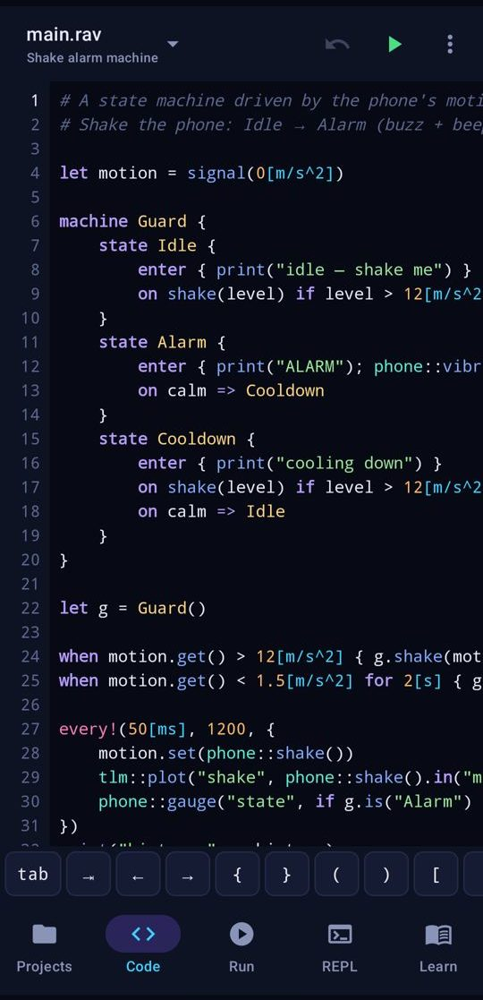
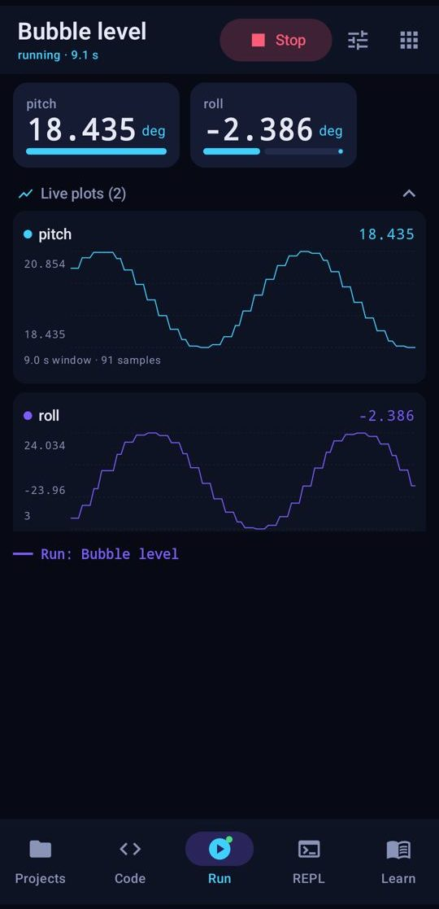
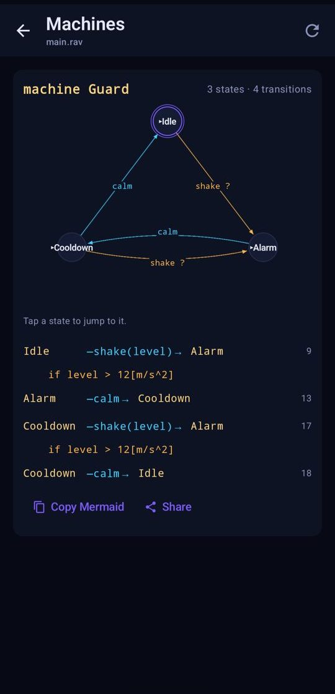
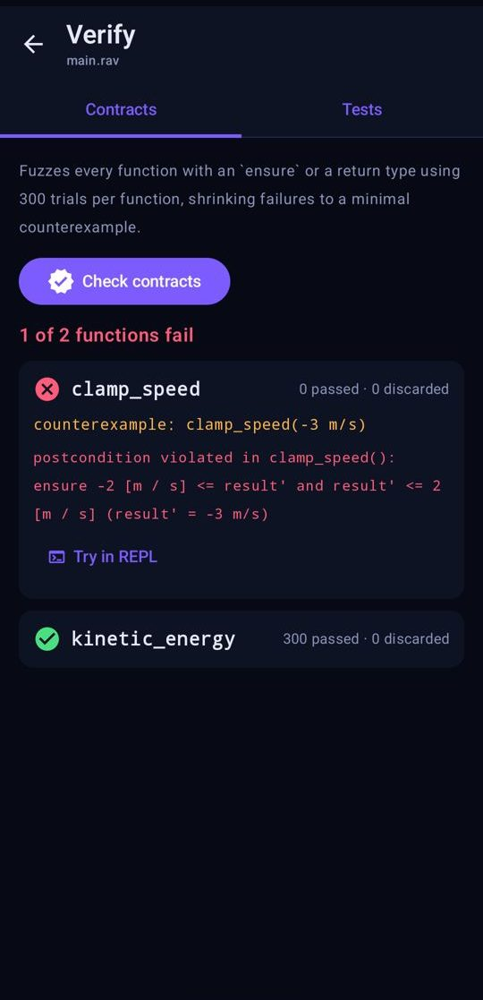
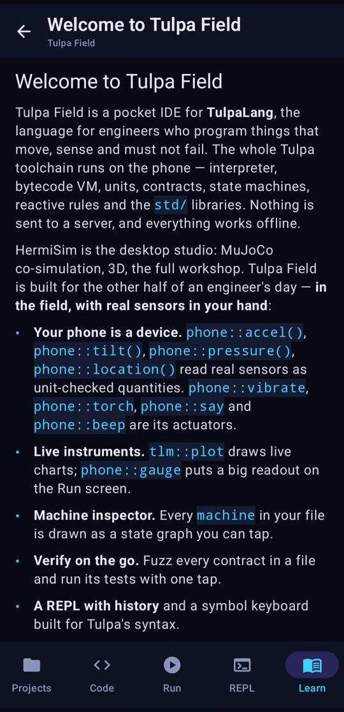
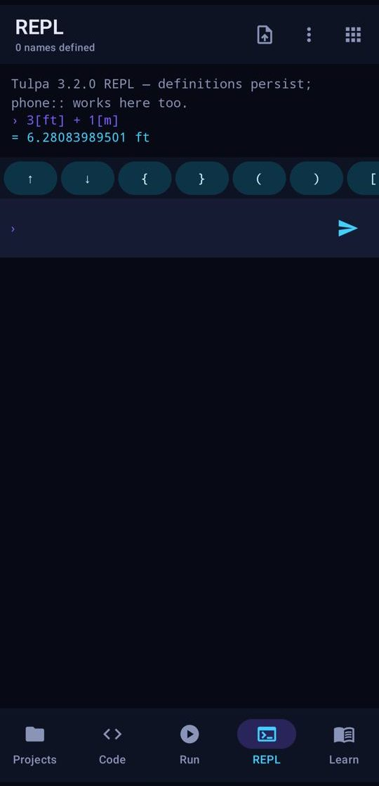
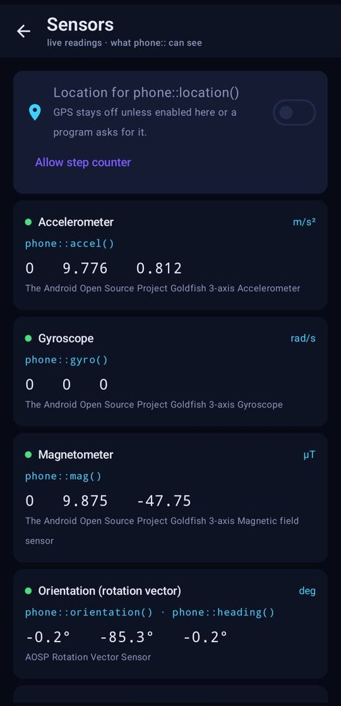

# Tulpa Field — TulpaLang IDE for Android

<p align="center">
  
  
  
  
  
</p>
<p align="center">
  
  
  
  
  
</p>
<p align="center"><sub>Welcome page · Morty and cart-pole in 3D co-simulation · editor · gauges & plots — machine inspector · verify · guide · REPL · sensors.
Captured by CI on an Android 14 emulator (<code>android/ci/smoke.sh</code>).</sub></p>

A pocket IDE for TulpaLang that runs the **entire Tulpa runtime on the phone** (interpreter,
bytecode VM, units, contracts, machines, signals, interfaces and the Driver SDK, `std/` libraries), turns the handset itself
into a device you can program, and carries **MuJoCo** for 3D co-simulation.

**Download:** the signed APK is attached to each [`android-v*` release](https://github.com/LoQiseaking69/TulpaLang/releases?q=android).
Site: [loqiseaking69.github.io/TulpaLang/android.html](https://loqiseaking69.github.io/TulpaLang/android.html).

What sets it apart from HermiSim (the desktop studio):

| | |
|---|---|
| **3D simulation + co-simulation** | MuJoCo 4 on the device with an OpenGL ES 3 view (orbit, pan, pinch, push, reset). `cosim::connect()` programs drive it with HermiSim's protocol, so HermiSim workspaces (`hermisim.json`) run unchanged; or point them at a desktop HermiSim |
| **Welcome page** | continue the last file, quick starts, highlights and recent projects |
| **`phone::` host module** | accelerometer, gyro, magnetometer, orientation, tilt, shake, light, barometer/altitude, proximity, battery, steps and GPS as unit-checked quantities; vibration, torch, speech, tones, toasts, notifications as actuators |
| **Live instruments** | `tlm::plot` charts, `phone::gauge` readouts, `tlm::event` markers and shareable artifacts on the Run screen |
| **Machine inspector** | every `machine` drawn as a tappable state graph, with guards, globals and Mermaid export |
| **Verify** | contract fuzzing (`check`) for the whole file, counterexamples you can replay in the REPL, and `define_test!` runs |
| **Touch-first editor** | syntax colouring, live diagnostics, completion (incl. `module::` members), outline, inspect, go-to-definition, find/replace, undo/redo, auto-indent, bracket pairing and a symbol/unit keyboard bar |
| **REPL** | persistent session with history, load-file, interrupt and reset |
| **Driver SDK (Tulpa 3.3)** | `interface`/`impl` with conformance checks, the `std/driver` interfaces and the MPU-6050 / PCA9685 / MCP3008 drivers on the simulated bus; *Your phone as an Imu* implements the same `Imu` interface on the handset's sensors. Firmware builds for RP2040/ESP32 run on a computer (`tulpa build --target`) |
| **Autonomy, middleware, simulation (Tulpa 3.4)** | `std/plan` (behavior trees, planning, missions), `std/link` on a simulated network, `std/world` physics with `std/emu` emulated chips behind the real drivers. `tulpa prove`, bundles and firmware builds run on a computer |
| **Learn** | 35 runnable examples (16 for the phone, plus cart-pole and Morty co-simulation) and an in-app guide whose code blocks run with one tap, plus the full language reference |

## Layout

```
android/
  native/          Rust cdylib: JNI bridge (lib.rs), phone:: module (phone.rs), MuJoCo shim
                   (csrc/hsim.c) + co-sim server (sim.rs), host tests
  app/             Kotlin + Jetpack Compose app
    src/main/tulpa/examples/   phone + co-sim examples (bundled with ../../examples)
    src/main/tulpa/models/     bundled MuJoCo models: cartpole, starter_model, morty
    src/main/tulpa/guide/      in-app guide chapters (bundled with ../../docs)
    src/main/assets/           catalog.json (library index) and guide.json (guide index)
  ci/smoke.sh      emulator smoke test: launches the app, runs code, captures the screenshots
  docs/screenshots/
  VERSION          bump on main to publish a signed release
```

The Gradle build copies `examples/`, `docs/` and `stdlib/` from the repository into the APK, so the
app always ships exactly what the toolchain ships. `import "std/…"` works on the phone.

The language side exposes an embedding API (`tulpa::embed`) and a host-module registry
(`tulpa::host`); `phone::` is just a host module registered by the bridge.

## Building

CI (`.github/workflows/android.yml`) does everything: host tests for the bridge (including running
every bundled example), `cargo ndk` for arm64-v8a / armeabi-v7a / x86_64, and `gradle
assembleRelease`. The APK is uploaded as a workflow artifact; pushing a tag `android-v1.2.3` (or
running the workflow with *publish*) attaches it to a GitHub release.

Locally you need the Android SDK + NDK, Rust with the Android targets, `cargo-ndk` and Gradle 8.11:

```sh
rustup target add aarch64-linux-android armv7-linux-androideabi x86_64-linux-android
cargo install cargo-ndk
(cd android/native && cargo test && cargo ndk -t arm64-v8a -t x86_64 --platform 26 -o ../app/src/main/jniLibs build --release)
(cd android && gradle assembleDebug)      # or open android/ in Android Studio
```

### Releases and signing

Releases are signed with the same HermiTech release keystore as the other Android apps, read
from four repository secrets: `KEYSTORE_BASE64` (the `.jks` file, base64), `KEYSTORE_PASSWORD`,
`KEY_ALIAS` and `KEY_PASSWORD`. The workflow verifies the APK with `apksigner` and prints the
certificate fingerprint in the log.

To ship a release, bump `android/VERSION` on main: CI builds, signs, runs the emulator smoke test
and publishes `android-v<version>` with the APK attached. A tag push `android-v1.2.3` or a manual
run with *publish* works too. Without the keystore secrets the APK is still built (debug-signed, as
a workflow artifact) but nothing is published, so an unsigned build never reaches the Releases page.
