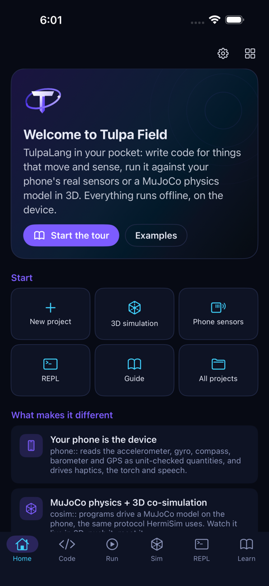
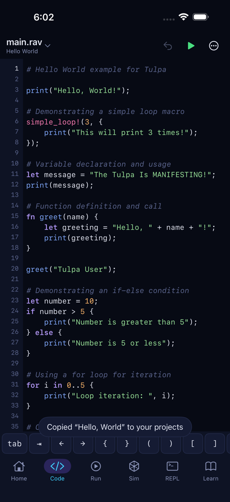
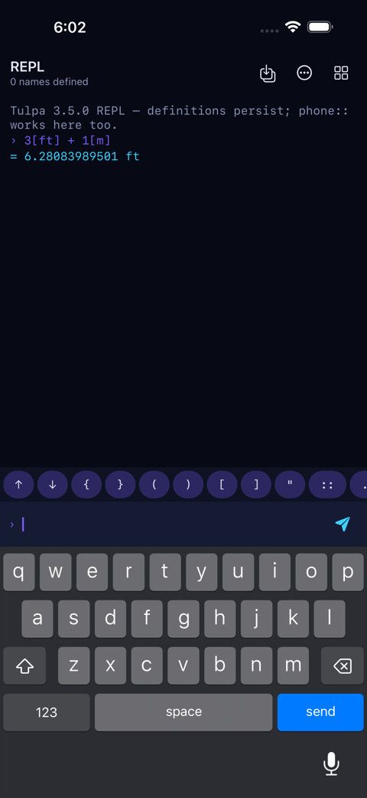
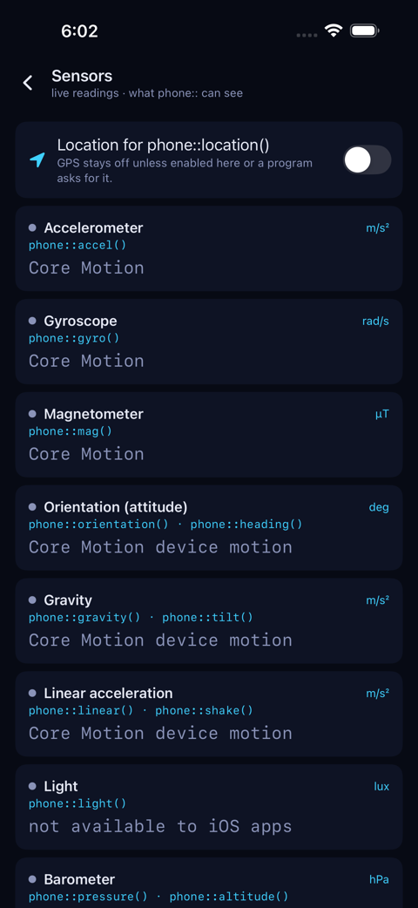
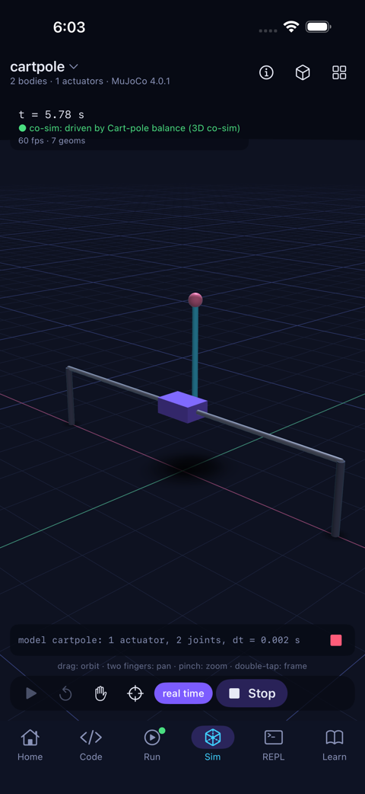

# Tulpa Field for iOS

The iPhone and iPad build of [Tulpa Field](../android/README.md), the Tulpa pocket IDE. It
runs the same Tulpa runtime as the Android app (interpreter, bytecode VM, units, contracts,
machines, `std/` libraries), the same `phone::` host module on the device's sensors, and
**MuJoCo 4** for 3D co-simulation, drawn with Metal.

| | |
|---|---|
| **Editor** | syntax colouring, live diagnostics, completion, outline, inspect, go-to-definition, find/replace, undo/redo, auto-indent and a symbol/unit bar |
| **Run** | console, stdin, live `phone::gauge` readouts and `tlm::plot` charts |
| **Sim** | MuJoCo models in 3D (drag to orbit, two fingers to pan, pinch to zoom, double-tap to frame), play/pause/reset/push, real-time or max speed, `cosim::` programs drive it with .RAV IDE's protocol |
| **REPL** | persistent session with history |
| **Learn** | the example library and the in-app guide with runnable code blocks |
| **Instruments** | sensors, machine inspector, verify & tests, bytecode, settings |
| **`phone::`** | accelerometer, gyro, magnetometer, orientation, barometer/altitude, proximity, battery, steps and GPS; haptics, torch, speech, tones and notifications |

<p>
  
  
  
  
  
</p>

Screenshots come from the CI simulator smoke test (iPhone, iOS 18).

## Install (no Apple Developer account)

Each `field-v*` [release](https://github.com/LoQiseaking69/TulpaLang/releases?q=field) carries
`TulpaField-<version>.ipa` next to the Android APK. The IPA is built without a signing identity
and given an **ad-hoc signature**; a sideloading tool re-signs it on your side with your own free
Apple ID. That is the standard way to install an app outside the App Store without a paid
developer membership.

**AltStore or SideStore (recommended)**

1. Install [AltStore](https://altstore.io) (AltServer on a Mac or PC) or
   [SideStore](https://sidestore.io) (no computer needed after setup) and sign in with your Apple ID.
2. Either add the source
   `https://github.com/LoQiseaking69/TulpaLang/releases/download/field-v<version>/altstore-source.json`
   (Sources → +), or download the IPA on the phone and open it in AltStore/SideStore (My Apps → +).
3. Settings → General → VPN & Device Management → trust your Apple ID, and on iOS 16+ turn on
   Settings → Privacy & Security → **Developer Mode** when prompted.

**Sideloadly** (Windows/macOS): connect the phone, drag the IPA in, enter your Apple ID, Start.

**TrollStore** (only on iOS versions it supports): open the IPA in TrollStore; no re-signing or
expiry.

Free Apple ID limits, set by Apple: apps signed this way **expire after 7 days** (AltStore and
SideStore refresh them in the background; Sideloadly needs a re-install), and at most **3
sideloaded apps** can be active at once. Your projects are kept in the app's Documents folder
(visible in the Files app under *On My iPhone → Tulpa Field*) and survive refreshes and updates.

Requires iOS 16 or later on an arm64 device with Metal (iPhone XS / iPad 8th gen or newer is
comfortable; every iOS 16 device works).

## Build it yourself

On a Mac with Xcode 16, Homebrew, and Rust (`rustup`):

```sh
brew install xcodegen ninja cmake
rustup target add aarch64-apple-ios aarch64-apple-ios-sim
ios/ci/build-mujoco.sh      # MuJoCo as static libraries for device + simulator  → ios/mujoco/
ios/ci/build-native.sh      # Rust bridge (Tulpa runtime + phone:: + MuJoCo shim) → ios/build/lib/
ios/ci/sync-assets.sh       # examples, guide, stdlib, models                     → ios/build/TulpaAssets/
ios/ci/gen-project.sh       # XcodeGen → ios/TulpaField.xcodeproj
open ios/TulpaField.xcodeproj
```

In Xcode you can run on a simulator right away. To run on your own phone with a free Apple ID,
pick your *Personal Team* under Signing & Capabilities and change the bundle identifier to
something unique (free teams cannot use `dev.hermitech.tulpafield`).

`ios/ci/smoke.sh` runs the XCUITest smoke suite (guide, library, editor, REPL, sensors, MuJoCo
co-sim) on the newest iPhone simulator and saves screenshots; `ios/ci/package-ipa.sh` archives a
Release build and writes `dist/TulpaField-<version>.ipa`. CI runs both in the `ipa` job of
[`.github/workflows/android.yml`](../.github/workflows/android.yml), and the `release` job
publishes the APK and the IPA together.

## Layout

```
ios/
  project.yml                 XcodeGen spec (app + UI test targets)
  native/                     Rust staticlib: C ABI over the Tulpa runtime, phone::, MuJoCo (shim shared with Android)
  TulpaField/Sources/
    Core/                     native bridge, workspace, runner, REPL, sensors (CoreMotion, CoreLocation, …), MuJoCo manager
    UI/                       SwiftUI screens: home, projects, editor (TextKit), run, REPL, learn, instruments
    Sim/                      Metal renderer + shaders for the MuJoCo view
  TulpaFieldUITests/          simulator smoke test
  ci/                         build, test and packaging scripts
  art/                        icon sources (from the Android adaptive icon)
```

The version is shared with Android (`android/VERSION`), so both apps ship from the same release.
