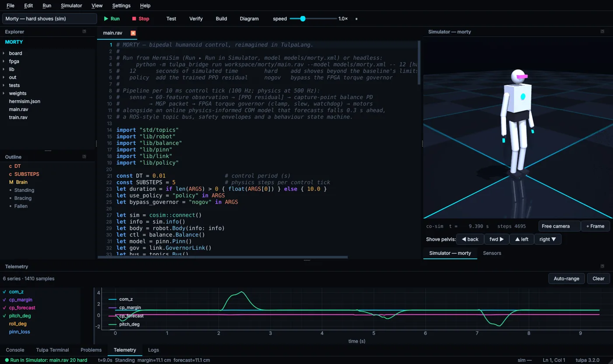
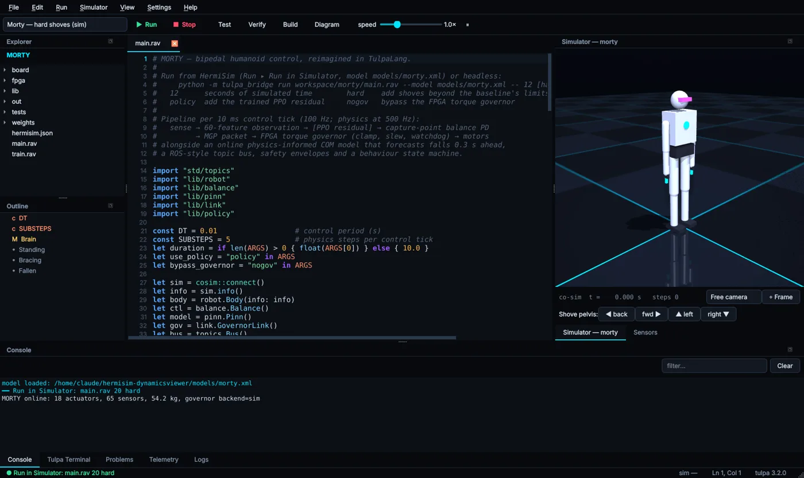
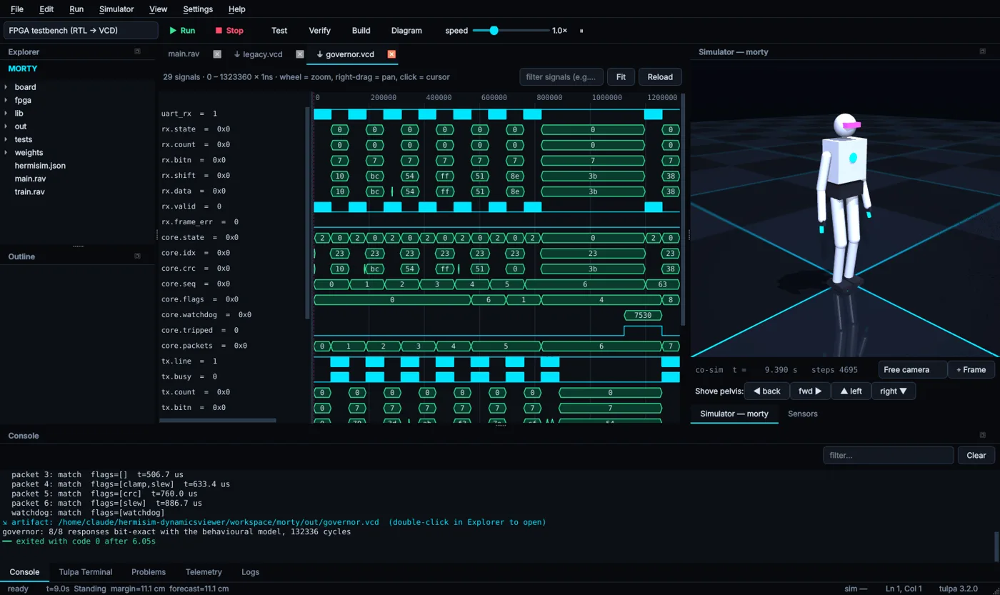
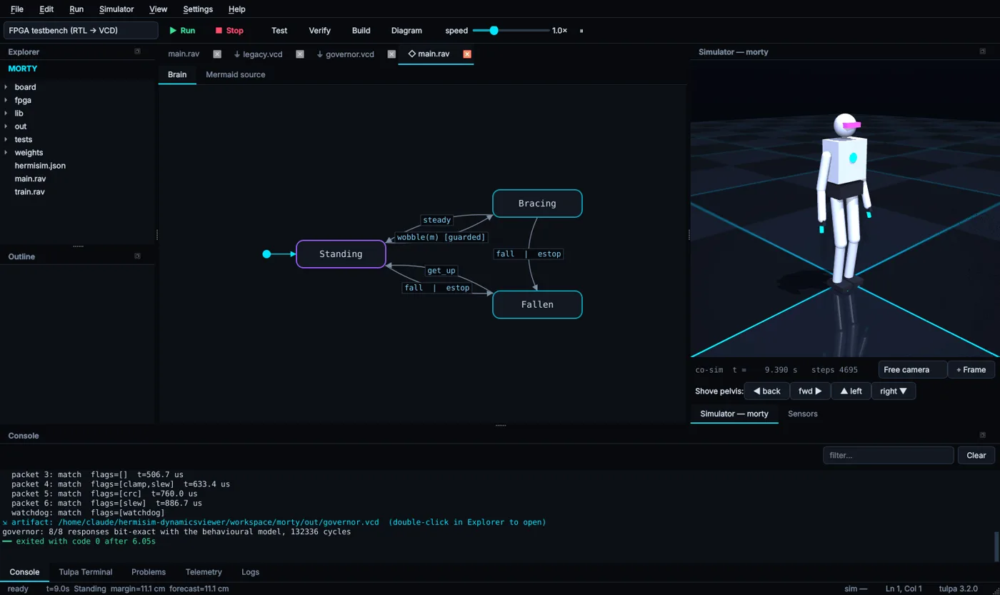
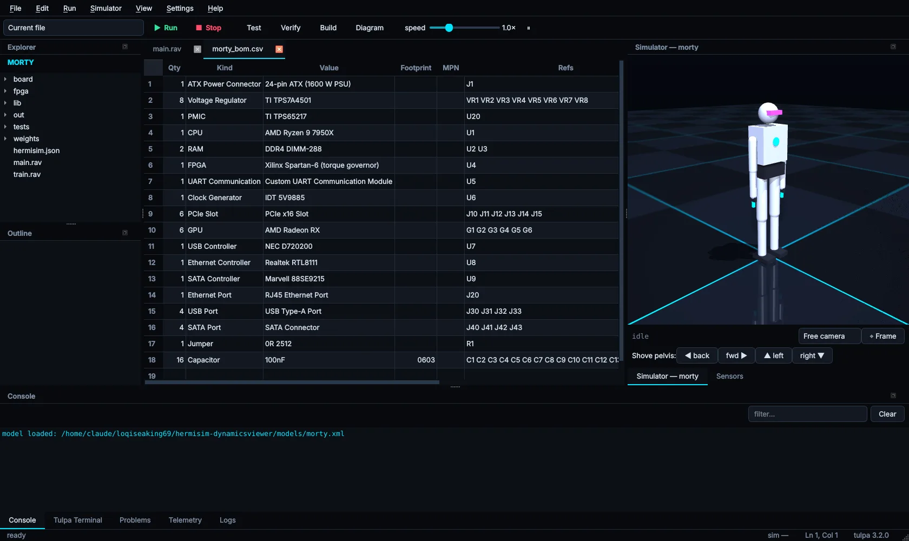

# IDE tour

HermiSim is an engineering workbench for writing robot software in Tulpa and testing it in one
window: MuJoCo physics driven in lock-step from Tulpa programs, cycle-accurate RTL models in a
waveform viewer, boards described as code, and live telemetry.



## Layout

| Area | What it holds |
|---|---|
| **Toolbar** | The run-target box (current file or a project run configuration), **▶ Run**, **■ Stop**, **Test**, **Verify**, **Build**, **Diagram**, and the simulation speed slider. |
| **Explorer / Outline** | The project tree, and an outline of constants, functions, structs and machines (with their states) in the open file. |
| **Editor** | Tabbed Tulpa editor with syntax highlighting and a language-server client. |
| **Simulator** | The MuJoCo viewport, simulation time and step count, camera controls and **Shove** buttons. A **Sensors** tab sits beside it. |
| **Bottom dock** | **Console**, **Tulpa Terminal**, **Problems**, **Telemetry** and **Logs**. |
| **Status bar** | Run state, `tlm::status` text, backend, cursor position and toolchain version. |

## Editor

- Syntax highlighting for `.rav` and `.tlp` files.
- A client for `tulpa lsp`: live diagnostics (including unit mismatches), hover, completion,
  undefined-name suggestions, document symbols and go-to-definition.
- Outline, find/replace and multiple tabs.



## Running code

One **▶ Run** button runs whatever is selected in the run-target box:

- **Current file** runs the open file. If the program calls `cosim::connect()`, a MuJoCo session
  starts automatically.
- A **project run configuration** from `hermisim.json`. See
  [Projects & run configurations](projects.md).

The toolbar's **Test**, **Verify**, **Build** and **Diagram** buttons map to `tulpa test`,
`tulpa verify`, `tulpa build` and the machine viewer.

## Viewers

| Viewer | Opens |
|---|---|
| **Telemetry** (bottom dock) | Live pyqtgraph plots fed by `tlm::plot`. |
| **Waveforms** (open a `.vcd`) | VCD files from `std/rtl` (or any Verilog simulator), with zoom, pan, a cursor and signal filtering. |
| **State diagrams** (toolbar **Diagram**) | Every `machine` in the current file, plus its Mermaid source. |
| **BOM / netlist** (open the CSV) | Tables for the CSV that `std/eda` exports. |

<div class="shots">







</div>

See [Telemetry & viewers](telemetry.md) for how programs feed them.

## Classic viewer

The original model viewer and model-builder wizard are still available:

```bash
python main.py --classic
```
