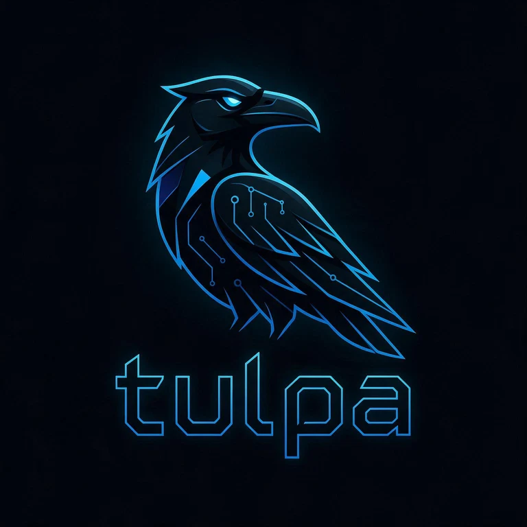

# Introduction

Welcome to the documentation for **Tulpa**, a Python-flavoured, Rust-powered programming
language for robotics, embedded systems and physical computing, and for the products built
around it.

Tulpa's central idea is that software which interacts with the physical world should be able to
express the rules of that world. Units of measure, engineering contracts, state machines,
reactive rules, timing constraints and safety envelopes are part of the language itself rather
than external libraries.

## The ecosystem

| Product | What it is | Runs on | Version |
|---|---|---|---|
| **Tulpa** | The language and toolchain: interpreter, bytecode VM, LLVM compiler, firmware VM, LSP | Linux, macOS, Raspberry Pi, RP2040, ESP32 | 3.5.0 |
| **.RAV IDE** | Desktop IDE and simulation suite: MuJoCo co-simulation, telemetry, proofs, deploy | Windows installer; Linux and macOS from source | 2.4.0 |
| **Tulpa Field** | The whole runtime on your phone: editor, sensors, 3D co-simulation, REPL | Android 8.0+, iOS 16+ | 1.5.1 |
| **TulpaTutor** | Interactive course on the real runtime compiled to WebAssembly | Web, Android, iOS | 1.1.0 |
| **Tulpa AI** | Agentic assistant that writes, fixes and explains Tulpa and checks it with the compiler | Android, iOS (private preview) | 0.2.0 |

[How it fits together](ecosystem.md) explains which product to reach for and how they share
the same toolchain.

## How these docs are organised

| Section | What you'll find |
|---|---|
| **Getting started** | Installing the toolchain and the IDE, writing and running your first program, and how the products fit together. |
| **Tulpa language** | The full language guide, the libraries, device integration, the Driver SDK, native and embedded targets (RP2040, ESP32), autonomy, the Tulpa Link middleware, simulation and proofs, the CLI and editor setup, plus a gallery of runnable examples. |
| **.RAV IDE** | A tour of the IDE, project files and run configurations, the co-simulation protocol, telemetry, the integrated terminal, headless CI use and the bundled Morty humanoid project. |
| **Tulpa Field** | Installing on Android and iOS, the `phone::` module, 3D co-simulation, and building the apps. |
| **TulpaTutor** and **Tulpa AI** | What each one covers and how it works. |
| **Project** | Roadmap, licensing and how to contribute to these docs. |

> [!TIP]
> New here? Read the [quick start](quickstart.md), then skim the
> [language guide](language-guide.md) sections on **units**, **state machines** and
> **safety envelopes**. They're what make Tulpa different. If you'd rather learn
> interactively, [TulpaTutor](tutor.md) runs in your browser.

## Source repositories

- [Tulpa](https://github.com/LoQiseaking69/Tulpa): the language, toolchain, standard library and VS Code extension.
- [dotRAV_IDE](https://github.com/LoQiseaking69/dotRAV_IDE): the IDE, co-simulator, Windows installer and the Morty project.
- [TulpaTutor](https://github.com/LoQiseaking69/TulpaTutor): the interactive course for web, Android and iOS.
- Tulpa Field lives in this repository, under `android/` and `ios/`.
