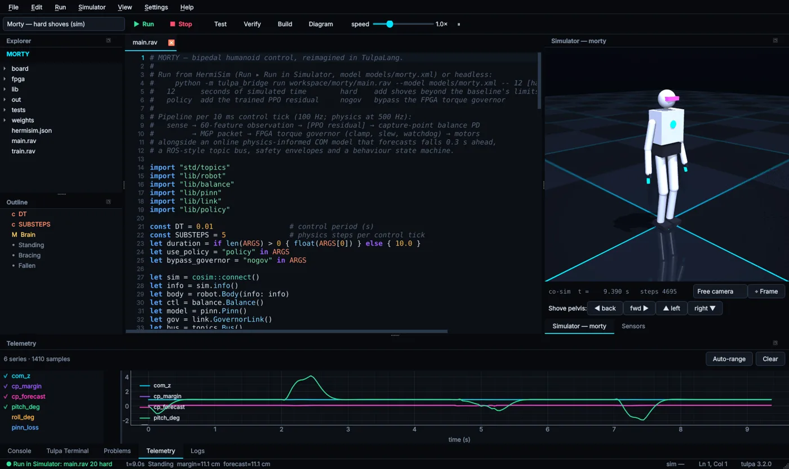

# The Morty project

HermiSim ships with **Morty**, a rewrite of the
[Morty bipedal humanoid](https://github.com/LoQiseaking69/Morty) written entirely in Tulpa. It
uses every 3.2 library and is the best end-to-end reference for how a full robot stack looks in
the language. You'll find it in `workspace/morty/`, or in `Documents\HermiSim` after a Windows
install.



## Control pipeline

`main.rav` runs the whole stack at **100 Hz**, with physics at 500 Hz:

```text
sense → 60-feature observation → [PPO residual] → capture-point balance PD
      → MGP packet → FPGA torque governor (clamp, slew, watchdog) → motors
```

Alongside it run an online physics-informed COM model that forecasts falls 0.3 s ahead, a
ROS-style topic bus, safety envelopes and a behaviour state machine
(`Standing` / `Bracing` / `Fallen`).

## From the original to Tulpa

| Original | In Tulpa (`workspace/morty/`) |
|---|---|
| `rospinn.py` PINN, whose COM loss was the mean of its own outputs | `lib/pinn.rav`: an `nn::` model of COM dynamics trained online on simulator data plus a residual from the Linear Inverted Pendulum model (`std/lipm`). Forecasts capture-point margin 0.3 s ahead. |
| `rospinn.py` RL "loss" `-log_prob.mean()` | `lib/policy.rav` and `train.rav`: real PPO (`std/rl`, GAE, clipped objective). The policy outputs a residual on top of the controller. |
| — | `lib/balance.rav`: capture-point balance controller (PD + ankle/hip strategy). |
| ROS topics | `std/topics`: a typed publish/subscribe bus on Tulpa signals, so `when` / `always` rules can watch topics. |
| `uart_comm.v` | `fpga/governor.rav`: a cycle-accurate RTL torque governor (`std/rtl`) with 8N1 UART RX/TX, CRC-checked packets, clamp, slew limiting and a watchdog. `fpga/testbench.rav` checks it bit-exactly against `fpga/protocol.rav` and writes a VCD. `fpga/legacy.rav` ports the original CPU, FPGA and UART modules. |
| `mortymb.py` gEDA XML | `board/motherboard.rav`: the board in `std/eda`, with ERC, a power budget in watts back through the regulators, a netlist and a BOM with costs. |
| `main.py` (iverilog + rosrun) | `main.rav`: the full pipeline above. |

## Run configurations

Open the project and pick one from the run-target box:

| Configuration | What it does |
|---|---|
| Morty — balance demo (sim) | 20 s of balancing at real time. |
| Morty — hard shoves (sim) | Adds pushes beyond the baseline controller's limits. |
| Morty — with learned policy | Adds the trained PPO residual. |
| Train residual policy (PPO) | Trains as fast as possible and saves to `weights/`. |
| FPGA testbench (RTL → VCD) | Simulates the governor and opens the waveform. |
| Mainboard ERC / power / BOM | Checks the board and writes netlist, BOM and JSON to `out/`. |
| Unit tests | `tulpa test tests/morty_test.rav`. |

`main.rav` takes positional arguments: seconds of simulated time, then any of `hard` (extra
shoves), `policy` (use the trained residual) and `nogov` (bypass the FPGA governor).

## Headless

```bash
python -m tulpa_bridge run workspace/morty/main.rav --model models/morty.xml -- 6 hard
```

```text
MORTY online: 18 actuators, 65 sensors, 54.2 kg, governor backend=sim
t= 2.00s  push [90.0, 0.0, 0.0] N
t= 4.50s  push [0.0, -130.0, 0.0] N

simulated 5.99 s in 1.41 s wall (4.2× real time)
falls: 0   brace warnings: 0   worst capture-point margin: 1.2 cm
PINN: 107 updates, data MSE 0.1105, physics MSE 0.0242
governor link: {"packets": 600, "bad": 0, "flags": {"slew": 22}, "backend": "sim"}
topics: /joint_states=600  /disturbance=2
behaviour history: Standing
```

The hardware side runs without a simulator:

```bash
cd workspace/morty
tulpa fpga/testbench.rav        # governor: 8/8 responses bit-exact with the behavioural model
tulpa board/motherboard.rav     # ERC, power budget, BOM → out/
tulpa test tests/morty_test.rav # 8 passed, 0 failed
```

The outputs above are from a real run on Tulpa 3.2.0 with MuJoCo 4.0.1. Timing varies by machine.
