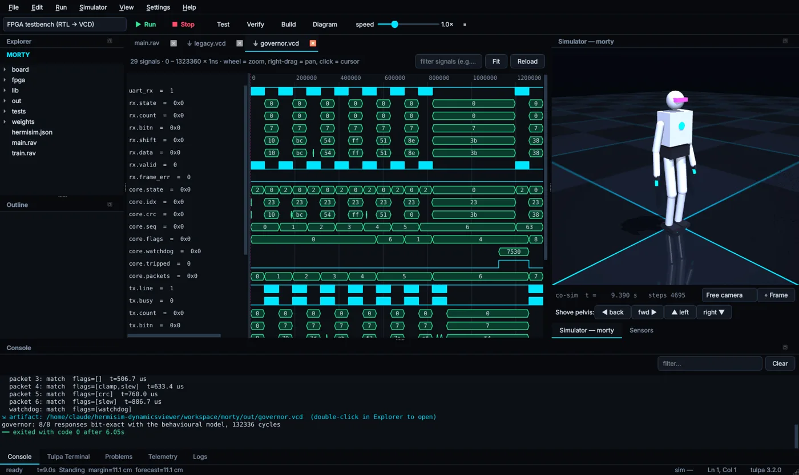
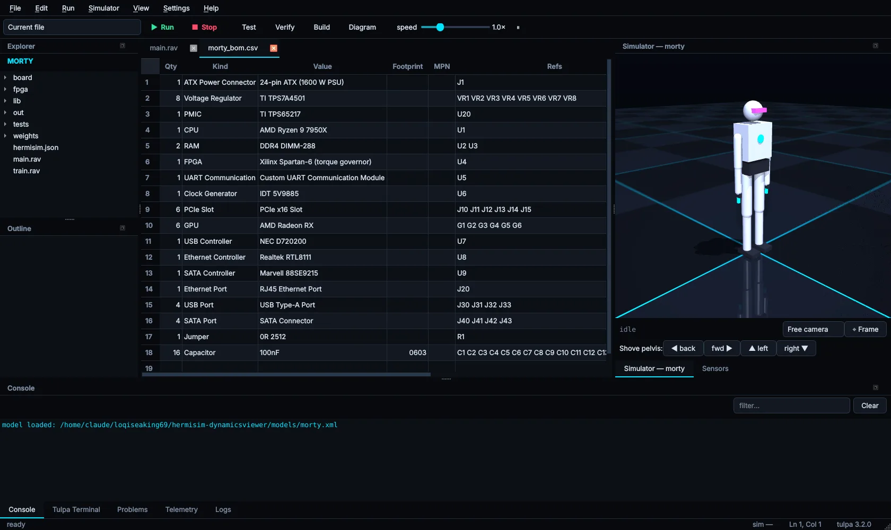

# Telemetry & viewers

Programs talk to the IDE through the `tlm::` module. When `TULPA_TELEMETRY=1` is set (HermiSim
sets it for every run), each call prints an `@@tlm {json}` line on stdout that the IDE picks up.
Without it the calls are no-ops, so the same program stays quiet on the command line and in CI.

## `tlm::` calls

| Call | Effect in HermiSim |
|---|---|
| `tlm::plot(name, value, t=nil)` | Adds a sample to the named series in **Telemetry**. Without `t`, the x-axis is time since the program started. |
| `tlm::event(name, data)` | Sends a marker or log event. |
| `tlm::status(text)` | Replaces the status-bar text, e.g. `Standing margin=11.1 cm`. |
| `tlm::artifact(path, kind)` | Offers to open a file the program produced: a VCD, a CSV or a netlist. |
| `tlm::enabled()` | `true` when telemetry is on. |

```tulpa
let speed = signal(0[m/s])
let ticks = every!(10, 5, {                 # every 10 ms, 5 times
    speed.set(speed.get() + 0.1[m/s])
    tlm::plot("speed_kmh", speed.get().in("km/h"))
    tlm::status(f"speed {speed.get().to("km/h"):.2f}")
})
print("ticks:", ticks, "telemetry:", tlm::enabled())
```

On the command line this prints only `ticks: 5 telemetry: false`. With telemetry on, the
stream the IDE parses looks like this:

```bash
TULPA_TELEMETRY=1 tulpa --virtual-time speed.rav
```

```text
@@tlm {"k":"plot","name":"speed_kmh","t":1.12e-7,"unit":null,"v":0.36}
@@tlm {"k":"status","text":"speed 0.36 km/h"}
...
ticks: 5 telemetry: true
```

## Telemetry panel

Series appear as they arrive. Toggle each one in the list, use **Auto-range** to refit, and
**Clear** to reset between runs.

## Waveform viewer

`std/rtl` writes standard VCD files with `sim.trace("out.vcd")`. Open them from the explorer,
or emit `tlm::artifact("out/governor.vcd", "vcd")` so the IDE offers to open the file when the
run finishes. The viewer supports zoom, pan, a cursor and signal filtering, and also reads VCDs
from Verilog simulators.



## Machine diagrams

Press **Diagram** in the toolbar to render every `machine` in the current file as a state
diagram, with a **Mermaid source** tab beside it. On the command line, `tulpa graph file.rav` prints the same
diagrams as Mermaid.

## BOM / netlist viewer

Boards written with `std/eda` can export a BOM, a netlist and a JSON description
(`write_bom`, `write_netlist`, `write_json`). Open the CSV from the explorer and HermiSim shows it
as a table: quantity, kind, value, footprint, MPN and reference designators. ERC results and the
power budget are printed to the console when the board program runs.


