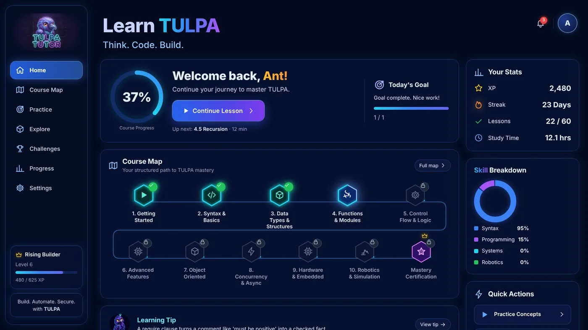

# TulpaTutor

TulpaTutor is the interactive course for Tulpa. It runs **Tulpa 3.5 compiled to
WebAssembly**, with the same interpreter, bytecode VM, units, contracts, state machines,
signals, simulated hardware bus and `std/` library the desktop toolchain uses. There is no
server: your code runs on your device.

It's available as a [web app](https://loqiseaking69.github.io/TulpaTutor/), an Android APK and
an iOS IPA. See the [downloads page](../download.html#tutor).

## The course

Ten modules and 60 lessons take you from `print` to autonomous robots:

| Module | Lessons |
|---|---|
| Getting Started | Welcome, values, variables, first units, reading errors, workflow |
| Syntax & Basics | Numbers, strings, booleans, bitwise, expressions, formatting |
| Data Types & Structures | Lists, dicts, ranges, units in depth, annotations, bytes |
| Functions & Modules | Functions, keyword arguments and pipes, closures, contracts, recursion, modules |
| Control Flow & Logic | Branching, `while` and `for` loops, `match`, errors, state machines |
| Advanced Features | Macros, signals, `when` rules, `always` monitors, verification, advanced machines |
| Object Oriented | Structs, methods, invariants, operators, interfaces, composition |
| Concurrency & Async | Tasks, pipelines, time, `every!`, timing rules, Tulpa Link |
| Hardware & Embedded | GPIO, I2C, SPI and UART, PWM and servos, PID, drivers |
| Robotics & Simulation | Kinematics, filtering, behavior trees, planning, physics worlds, a capstone rover |

Lessons contain 306 runnable, editable snippets, 60 exercises and 122 quiz questions. An
exercise is checked by running your program: it has to produce the expected output and pass
hidden checks.

> [!NOTE]
> The course is validated in CI. Every snippet and every exercise solution is run against
> the runtime before a release ships, and every exercise starter is checked to make sure it
> doesn't already pass.

## Beyond the lessons

- **Practice**: spaced-repetition review, code drills from finished lessons and timed
  lightning rounds.
- **Challenges**: 14 standalone problems, from easy to hard, with hidden tests.
- **Explore**: an editor with live diagnostics and completion, a REPL, state-machine
  diagrams, contract fuzzing, a `define_test!` runner, example programs and a searchable
  language reference.
- **Mastery Certification**: 20 questions from a 32-question pool and 3 capstone programs
  checked by the runtime, with a certificate you can save as an image.
- **Progress**: XP and levels, streaks, a skill breakdown and 14 achievements.

## Installing

| Platform | How |
|---|---|
| Web | Open the [web app](https://loqiseaking69.github.io/TulpaTutor/). It works offline once loaded. |
| Android | Install `TulpaTutor-<version>.apk` (Android 8.0+). |
| iPhone and iPad | Sideload `TulpaTutor-<version>.ipa` with AltStore, SideStore or Sideloadly (iOS 15+). |
| Self-hosted | Unzip `TulpaTutor-web-<version>.zip` onto any static file server. |

Source, build instructions and the lesson format are in the
[TulpaTutor repository](https://github.com/LoQiseaking69/TulpaTutor).
